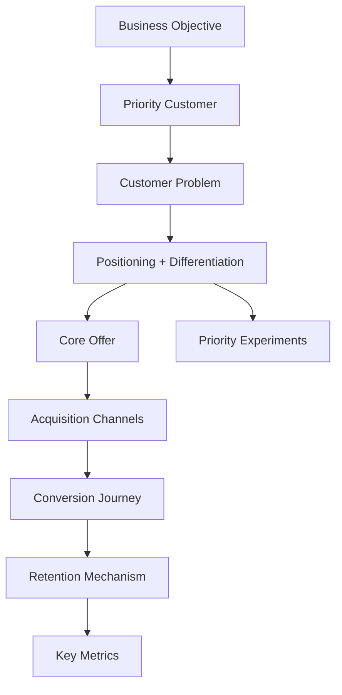

# Module 10: Visual Strategy Canvas

A single diagram summarizing the recommended marketing system. Use when it genuinely clarifies the strategy (several moving parts, a journey or flow that's easier to see than read). Skip it when the strategy is simple enough that a diagram would just restate three lines of text in box form.

## What to include

- Business objective
- Priority customer (segment or ICP)
- Customer problem
- Positioning statement
- Differentiation
- Core offer
- Core message
- Acquisition channel(s)
- Conversion journey (key steps)
- Retention mechanism
- Key metrics
- Priority experiments

Keep it to what fits on one readable diagram. If there's too much to fit cleanly, that's a sign the strategy itself isn't focused enough yet, simplify the strategy rather than cramming the canvas.

## Format

Use Mermaid, since it's portable and renders in most Claude surfaces. A flowchart or simple graph works well for this; don't force it into a diagram type that doesn't suit the content (no pie charts, no forced org-chart hierarchy if the relationships aren't actually hierarchical).

Example skeleton (adapt structure to the actual content, don't fill this template mechanically):

If the rendering environment can't display Mermaid for some reason, still provide the Mermaid source (it's readable as text) rather than omitting the canvas entirely.

## What to avoid

- Decorative diagrams that don't carry real information (a nice-looking box diagram that just repeats the text above it adds nothing)
- Overcrowding: more than roughly 10-12 nodes usually means the canvas needs to be simplified, not expanded
- Claiming interactivity the environment doesn't actually support
